<!-- Generated by assets/gen_profile.py ("Verre d'encre" art direction). Edit the script, not this block. -->
<!-- profile:start -->
<a href="https://raw.githubusercontent.com/Kureo524/Kureo524/main/CV-Monnier-Kilian.pdf"></a><a href="mailto:kilian.monnier524@gmail.com"></a><a href="https://kuko524.itch.io">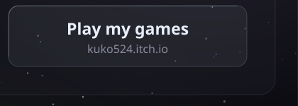</a><a href="https://kureo524.github.io/Manhwadle/"></a><a href="https://kureo524.github.io/Manhwadle/"></a><a href="https://github.com/Kureo524/Manhwadle/releases/latest"></a><a href="https://github.com/Kureo524/Manhwadle"></a><a href="https://github.com/Kureo524/CraftingSimulator"></a><a href="https://github.com/Kureo524/Aegis/releases/latest"></a><a href="https://github.com/theo-bsl/Taille"></a>
<!-- profile:end -->
