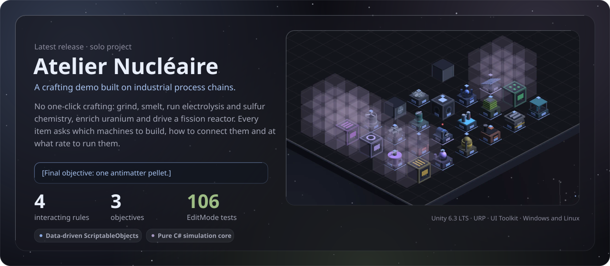
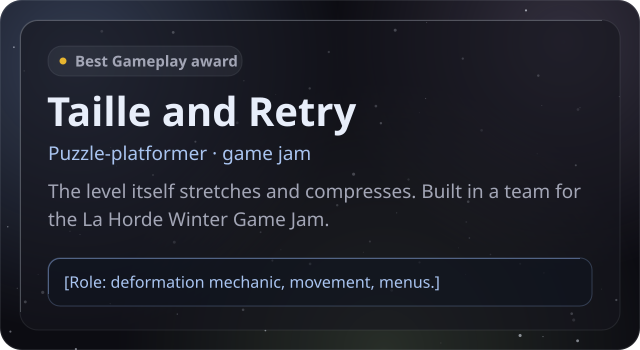
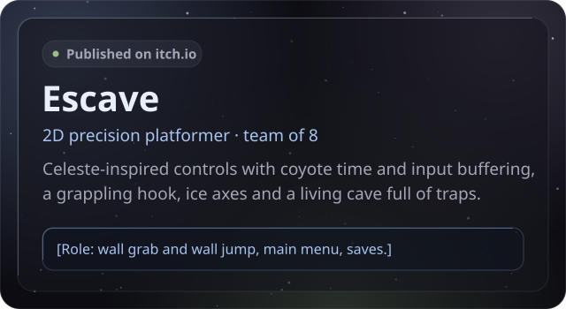
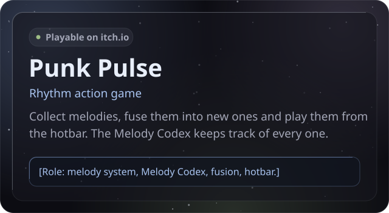
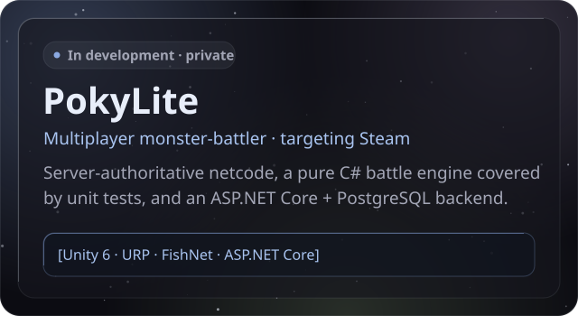
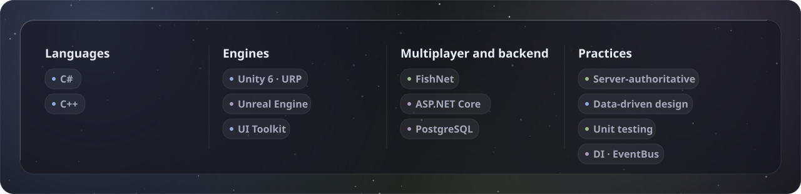

  

  
  
  

## Featured project

  

  <a href="https://github.com/Kureo524/CraftingSimulator/releases/latest"><b>Download for Windows or Linux</b></a> ·
  <a href="https://github.com/Kureo524/CraftingSimulator"><b>Source</b></a> ·
  <a href="https://github.com/Kureo524/CraftingSimulator/blob/main/Docs/MesRegles.md"><b>Crafting rules</b></a> (FR)

## Projects

  
  
  
  

  
    Taille and Retry: <a href="https://github.com/theo-bsl/Taille">source</a> ·
    Escave: <a href="https://lucasdrpx.itch.io/escave">play</a>, <a href="https://github.com/lucasdprx/Escave">source</a> ·
    Punk Pulse: <a href="https://lawice2.itch.io/punk-pulse">play</a>, <a href="https://github.com/Gabriel-Etienne/Instance2---2026">source</a> ·
    Also in development: <b>Tower of the Apocalypse</b>, a data-driven turn-based mobile RPG (Unity 6 · URP, private)
  

## Toolbox

  

  

Visuals generated by <a href="assets/gen_profile.py"><code>assets/gen_profile.py</code></a> in the “Verre d'encre” art direction · fonts under the OFL: Gothic A1, Barlow Condensed, IBM Plex Mono.

