<!-- Profile of Kilian Monnier. Generated by assets/gen_profile.py; edit the script, not this file. -->
<a href="https://raw.githubusercontent.com/Kureo524/Kureo524/main/CV-Monnier-Kilian.pdf"></a><a href="mailto:kilian.monnier524@gmail.com"></a><a href="https://kuko524.itch.io"></a><a href="https://github.com/Kureo524/CraftingSimulator"></a><a href="https://github.com/Kureo524/CraftingSimulator/releases/latest"></a><a href="https://github.com/Kureo524/CraftingSimulator"></a><a href="https://github.com/Kureo524/CraftingSimulator/blob/main/Docs/MesRegles.md"></a><a href="https://github.com/theo-bsl/Taille"></a><a href="https://github.com/Kureo524/Kureo524/blob/main/projects/taille-and-retry.md"></a><a href="https://github.com/theo-bsl/Taille"></a><a href="https://github.com/Kureo524/Kureo524/blob/main/projects/escave.md"></a><a href="https://github.com/theo-bsl/Taille"></a><a href="https://github.com/Kureo524/Kureo524/blob/main/projects/punk-pulse.md"></a><a href="https://github.com/theo-bsl/Taille"></a><a href="https://github.com/Kureo524/Kureo524/blob/main/projects/pokylite.md">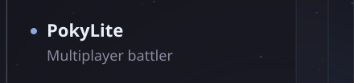</a><a href="https://github.com/theo-bsl/Taille"></a><a href="https://github.com/Kureo524/Kureo524/blob/main/projects/tower-of-the-apocalypse.md"></a><a href="https://github.com/theo-bsl/Taille">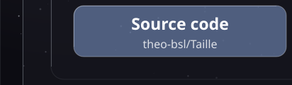</a><a href="https://github.com/Kureo524/Kureo524/blob/main/projects/aegis.md"></a>
